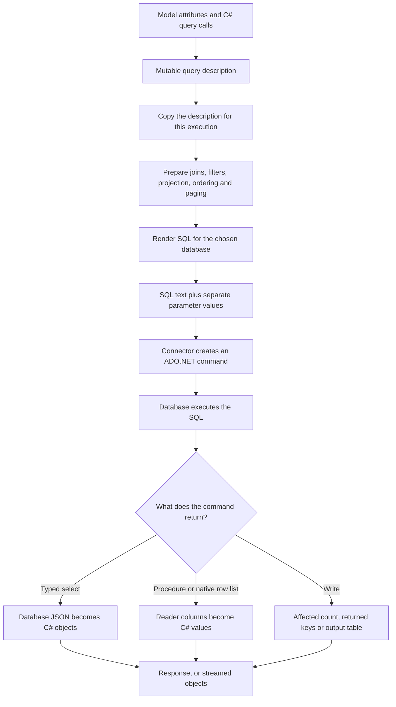

[NuGet usage guides](../docs/README.md)

# How C# becomes SQL and results become objects

SqlLinqer builds a description of a query, renders it for your database, and asks an ADO.NET provider to execute it.
For ordinary typed selects, the database returns JSON. SqlLinqer reads that JSON into your C# models, including selected relationships.
Writes and stored procedures use different result paths.



## Follow one select

This example uses the mapped `User` model and connector from the [getting started guides](../docs/getting-started/model-mapping.md).

```csharp
var query = User.BeginSelect(connector)
    .SelectRootColumns()
    .Select(user => user.Manager)
    .Where(user => user.Name, "Ada", SqlOp.EQ)
    .OrderBy(user => user.Id, SqlDir.ASC)
    .Page(1, 20);

var response = query.Execute();
if (response.State != ResponseState.Valid)
    throw response.Error;

var users = response.Result;
```

The calls above `Execute()` describe the query. They do not contact the database.

1. **Read the mappings.** Attributes describe the table, database column names, primary key, and manager relationship.
   `ParsedType` and `Table` cache this information so later queries can reuse it.
2. **Build the query description.** `Select`, `Where`, and the other calls add query objects.
   The expression `user => user.Name` identifies a mapped member. `"Ada"` remains a separate value.
   A `BuildQuery(...)` projection also translates SQL marker calls such as `Count()` and `LOWER(...)`.
3. **Copy the description.** Rendering works on a detached copy of the mutable query objects.
   Compiler changes, such as discovering a join or adding paging order, stay in that copy.
4. **Prepare and render SQL.** The compiler resolves selected members, relationship subqueries, filters, grouping, ordering, and paging.
   The dialect supplies database-specific SQL and JSON expressions.
5. **Bind and execute.** The connector obtains a configured provider connection from the factory and creates a command.
   It puts SQL text in `CommandText` and values in `DbParameter` objects, then executes the command.
6. **Load the result.** The mapper reads database JSON and constructs `User` objects.
   The nested manager JSON becomes the selected `Manager` property.
   Buffered execution returns a `SqlResponse<List<User>>`.

The database engine chooses the execution plan and performs filtering, sorting, aggregation, and JSON construction.
SqlLinqer does not filter the returned models in memory to implement `Where`.

## What crosses the database connection

`RenderedQuery` carries SQL text and a parameter collection together.
For the example, the SQL contains a generated placeholder for `"Ada"`, and the provider receives its value separately.
Exact SQL differs by database and includes generated aliases and JSON projection expressions.

| Result path | What the database returns | How SqlLinqer loads it |
| --- | --- | --- |
| Typed select on PostgreSQL, MySQL, SQLite, or DuckDB | One JSON object per root result row | Deserialize each object into the requested model or projection |
| Typed select on SQL Server or Azure SQL | A JSON array, possibly split across text rows | Reassemble it for buffered loading, or parse fragments incrementally for streaming |
| Typed stored procedure | One tabular result set and standard output parameters | Match reader columns to row members, then read metadata after the reader closes |
| `ExecuteReaderList<T>` | Native reader columns | Convert values and assign flat model members, without relationship loading |
| Write | An affected-row count, or selected output columns | Return a count, convert returned primary keys, or buffer a `DataTable` |

Related objects usually come from nested SQL JSON expressions in the same command.
Selecting a relationship does not issue a separate client query for every root row.
It can still add substantial work inside the database.

SQL model mappings control database loading.
For example, `SqlColumn` can name a database column differently from its C# property, while the generated JSON uses the C# result member name.
Application JSON attributes and converters do not control this database contract.

## Buffered results, streaming, and totals

`Execute()` and `ExecuteAsync()` load the complete result list before returning it.
`ExecuteAsyncStream()` starts database execution when enumeration begins and yields complete root objects as they become available.
Each streamed object still allocates its own strings, collections, and other owned values.
Dispose the enumeration, including after an early exit, to release its database resources.

`ExecuteWithTotalCount()` uses the same query definition for the page and its unpaged count.
For a limited query, it executes two commands: the data query and a count query with root paging removed.
Grouped and distinct queries count their result groups or distinct results.
Without root paging, it can use the returned list count instead.

A query snapshot freezes the query description. It does not freeze database contents between those two commands.
Database consistency still depends on the transaction and isolation level used by the caller.

## Where writes and procedures branch

Insert, update, and delete builders use the same mapping, rendering, parameter-binding, and connector concepts.
Their renderers produce write SQL rather than a SELECT JSON projection.
Ordinary inserts can split rows into batches to respect parameter and SQL Server VALUES limits.
Multiple batches share a write transaction.

SQL Server TVP inserts have an additional path.
SqlLinqer copies mapped values into a `DataTable`, creates a temporary table type, passes the table as a structured parameter, and removes the type.
Type creation and removal use separate connections from the write transaction.

`SqlLinqerCallable<TInput, TOutput>` is the typed stored-procedure entry point for SQL Server and Azure SQL.
It reads the input model, prepares a parameterized EXEC batch, and maps one tabular result set into `TOutput` rows.
The reader must close before SqlLinqer reads the return code and optional standard total-count output.
The result is a `SqlCallableResponse<TOutput>` containing rows and available metadata.

## Ownership and failures

Finish changing a builder before capturing or executing it.
Use `Capture()` when you want a detached definition that can render repeatedly or concurrently.
Each render still performs compilation and copies working state. A snapshot is not a cached SQL command.
Supported arrays, binary buffers, and `DataTable` inputs are copied. Other provider-specific reference values require the documented immutable lifetime.

Without a supplied transaction, the connector owns and disposes its execution connection.
The application factory supplies connection settings, including login timeout, pooling, and authentication.
SqlLinqer keeps those settings and applies its command execution options separately.
Execution methods accept a per-call `commandTimeout` that overrides the connector default without mutating shared options.
The effective timeout applies independently to each command in a page/count pair, insert batch, or TVP operation.
Write execution normally also owns its transaction.
With a supplied transaction, the caller keeps ownership of its connection, commit, rollback, and disposal.

Check `State` before reading a buffered response's `Result`.
Database and mapping failures normally produce an error response containing the rendered command context.
Validation or rendering can throw before execution starts. Requested async cancellation throws.
Streaming failures throw during enumeration, after the caller may already have processed some rows.

## Find the implementation

| Responsibility | Main source |
| --- | --- |
| Model attributes and query entry points | [Modeling](Modeling/SqlLinqerObject.cs) |
| Cached model mappings | [ParsedType](Components/Modeling/ParsedType.cs), [Table](Components/Modeling/Table.cs) |
| Query capture and working copies | [QuerySnapshot](Compilation/QuerySnapshot.cs), [SnapshotGraph](Compilation/SnapshotGraph.cs) |
| SELECT preparation and dialect assembly | [SelectPreparation](Compilation/SelectPreparation.cs), [SqlDialect](Compilation/SqlDialect.cs) |
| Shared SELECT execution and totals | [SelectExecution](Queries/Execution/SelectExecution.cs) |
| Provider parameters and command lifetime | [BaseConnector](Connections/BaseConnector.cs), [execution](Connections/BaseConnector.Execution.cs) |
| JSON loading and SQL model construction | [JsonResultMapper](Components/Json/JsonResultMapper.cs), [DatabaseModelConverterFactory](Components/Json/DatabaseModelConverterFactory.cs) |
| Streaming command and text-fragment lifetime | [Streaming connector](Connections/BaseConnector.Streaming.cs), [JsonFragmentStream](Components/Json/JsonFragmentStream.cs) |
| Procedure compilation and tabular mapping | [CallablePreparation](Compilation/CallablePreparation.cs), [TabularRowType](Components/Modeling/TabularRowType.cs) |

See the source files above for extension hooks and compilation details.
