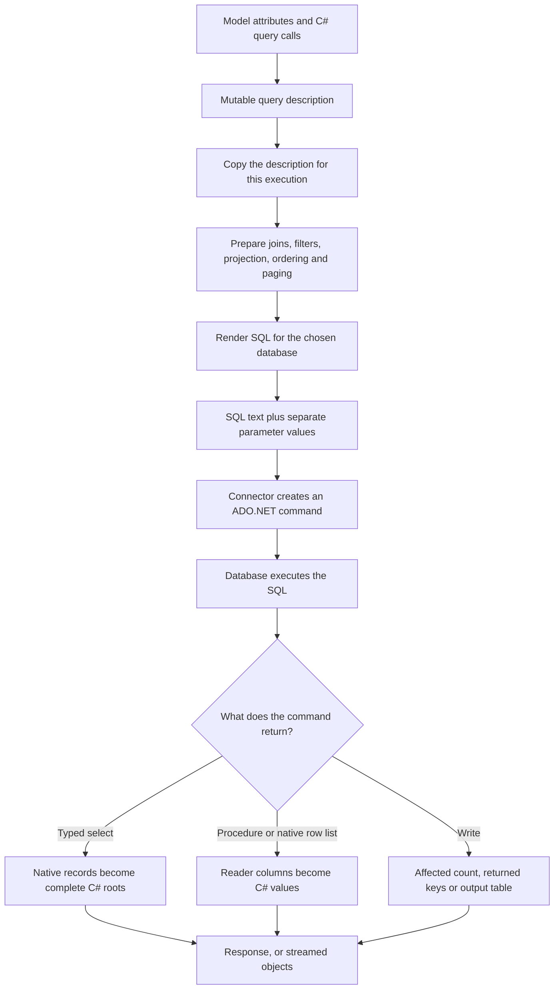

[NuGet usage guides](../docs/README.md)

# How C# becomes SQL and results become objects

SqlLinqer builds a description of a query, renders it for your database, and asks an ADO.NET provider to execute it.
Typed selects use native provider values. SqlLinqer constructs complete C# roots, including their selected relationships.
Writes and stored procedures use different result paths.



## Follow one select

This example uses the mapped `User` model and connector from the [getting started guides](../docs/getting-started/model-mapping.md).

```csharp
var query = User.BeginSelect(connector)
    .SelectRootColumns()
    .Select(user => user.Manager)
    .Where(user => user.Name, "Ada", SqlOp.EQ)
    .OrderBy(user => user.Id, SqlDir.ASC)
    .Page(1, 20);

var response = query.Execute();
if (response.State != ResponseState.Valid)
    throw response.Error;

var users = response.Result;
```

The calls above `Execute()` describe the query. They do not contact the database.

1. **Read the mappings.** Attributes describe the table, database column names, primary key, and manager relationship.
   `ParsedType` and `Table` cache this information so later queries can reuse it.
2. **Build the query description.** `Select`, `Where`, and the other calls add query objects.
   The expression `user => user.Name` identifies a mapped member. `"Ada"` remains a separate value.
   A `BuildQuery(...)` projection also translates SQL marker calls such as `Count()` and `LOWER(...)`.
3. **Copy the description.** Rendering works on a detached copy of the mutable query objects.
   Compiler changes, such as discovering a join or adding paging order, stay in that copy.
4. **Prepare and render SQL.** The compiler resolves selected members, relationship subqueries, filters, grouping, ordering, and paging.
   The compiler supplies database-specific native result plans.
5. **Bind and execute.** The connector obtains a configured provider connection from the factory and creates a command.
   It puts SQL text in `CommandText` and values in `DbParameter` objects, then executes the command.
6. **Load the result.** The mapper reads native values and constructs `User` objects.
   The selected manager is complete before its root is returned.
   Buffered execution returns a `SqlResponse<List<User>>`.

The database engine chooses the execution plan and performs filtering, sorting, aggregation, and native result production.
SqlLinqer does not filter the returned models in memory to implement `Where`.

## What crosses the database connection

`RenderedQuery` carries SQL text and a parameter collection together.
For the example, the SQL contains a generated placeholder for `"Ada"`, and the provider receives its value separately.
Exact SQL differs by database and includes generated aliases and native occurrence metadata.

| Result path | What the database returns | How SqlLinqer loads it |
| --- | --- | --- |
| Typed select on server providers or DuckDB | Native scalar columns and positional nested records | Assemble one complete root at a time using explicit current-root completion metadata |
| Typed nested select on SQLite | Native root cursor and prepared child cursors on the same connection | Finish the current root's descendants before advancing the root cursor |
| Typed stored procedure | One tabular result set and standard output parameters | Match reader columns to row members, then read metadata after the reader closes |
| `ExecuteReaderList<T>` | Native reader columns | Convert values and assign flat model members, without relationship loading |
| Write | An affected-row count, or selected output columns | Return a count, convert returned primary keys, or buffer a `DataTable` |

Server providers and DuckDB expand related objects in one correlated command. SQLite reuses prepared local child commands.
Both paths retain only the current root while streaming.

`SqlDialect` owns shared native SQL defaults and provider-specific correlated expansion, derived ordering, and control-value types. SQLite selects the local-child reader strategy. Provider execution settings, such as DuckDB streaming mode, stay in connector execution.

Compiled `NativeResultPlan` layout and command descriptions contain no CLR model bindings. `BoundNativeResultPlan` creates execution-local bindings against that layout. `SqlModelType` owns constructor resolution and compiled member access for native and tabular model loading. Tabular binding still requires a complete unambiguous schema; SELECT projections allow omitted members.

DISTINCT remains a SQL operation on each query node. The projection includes its selected scalar values and hidden ancestor inputs needed by selected descendants. Hidden correlation values participate in DISTINCT so different parents retain their own nested data. Parent DISTINCT never compares nested collections or propagates to child queries. SQL paging follows DISTINCT; occurrence numbering follows the resulting page.

There is no graph equality-key payload, retained graph comparison state, captured-node storage, or DISTINCT resource scope. SQLite uses the same prepared local cursors for distinct and ordinary queries, including under `PRAGMA query_only=ON`. Counts execute server COUNT SQL over the unpaged root projection and its required correlation values, without transferring or constructing children.

Typed SELECT extensions use `SelectQuery.CompileSelect(flavor, count)` on a detached working definition. Call `base.CompileSelect` and preserve the result layout when modifying its SQL. The string-only `Render(parameters, flavor)` method does not control typed snapshot execution. Keeping these interfaces separate avoids recursive virtual rendering and ensures count compilation receives the unpaged definition.

SQL model mappings control database loading.
For example, `SqlColumn` can name a database column differently from its C# property, while native projection aliases identify the C# result members.
Application JSON attributes and converters do not control this database contract.

## Buffered results, streaming, and totals

`Execute()` and `ExecuteAsync()` load the complete result list before returning it.
`ExecuteAsyncStream()` starts database execution when enumeration begins and yields complete root objects as they become available.
Each streamed object still allocates its own strings, collections, and other owned values.
Dispose the enumeration, including after an early exit, to release its database resources.

`ExecuteWithTotalCount()` uses the same query definition for the page and its unpaged count.
For a limited query, it performs the data operation and a count operation with root paging removed.
Totals use server COUNT SQL over the root row projection.
Grouped and distinct queries count their result groups or distinct results.
Without root paging, it can use the returned list count instead.

A query snapshot freezes the query description. It does not freeze database contents between those two commands.
Database consistency still depends on the transaction and isolation level used by the caller.

## Where writes and procedures branch

Insert, update, and delete builders use the same mapping, rendering, parameter-binding, and connector concepts.
Their renderers produce write SQL rather than a native SELECT result plan.
Ordinary inserts can split rows into batches to respect parameter and SQL Server VALUES limits.
Multiple batches share a write transaction.

SQL Server TVP inserts have an additional path.
SqlLinqer copies mapped values into a `DataTable` and passes it as a structured parameter. The connector manages reusable leased table types by default; disabling reuse selects the per-execution type lifetime.
Type management uses separate connections from the write transaction.

`SqlLinqerCallable<TInput, TOutput>` is the typed stored-procedure entry point for SQL Server and Azure SQL.
It reads the input model, prepares a parameterized EXEC batch, and maps one tabular result set into `TOutput` rows.
The reader must close before SqlLinqer reads the return code and optional standard total-count output.
The result is a `SqlCallableResponse<TOutput>` containing rows and available metadata.

## Ownership and failures

Finish changing a builder before capturing or executing it.
Use `Capture()` when you want a detached definition that can render repeatedly or concurrently.
Each render still performs compilation and copies working state. A snapshot is not a cached SQL command.
Supported arrays, binary buffers, and `DataTable` inputs are copied. Other provider-specific reference values require the documented immutable lifetime.

Without a supplied transaction, the connector owns and disposes its execution connection.
The application factory supplies connection settings, including login timeout, pooling, and authentication.
SqlLinqer keeps those settings and applies its command execution options separately.
Execution methods accept a per-call `commandTimeout` that overrides the connector default without mutating shared options.
The effective timeout applies independently to each command in a page/count pair, insert batch, or TVP operation.
Write execution normally also owns its transaction.
With a supplied transaction, the caller keeps ownership of its connection, commit, rollback, and disposal.

Check `State` before reading a buffered response's `Result`.
Database and mapping failures normally produce an error response containing the rendered command context.
Validation or rendering can throw before execution starts. Requested async cancellation throws.
Streaming failures throw during enumeration, after the caller may already have processed some rows.

## Find the implementation

| Responsibility | Main source |
| --- | --- |
| Model attributes and query entry points | [Modeling](../SqlLinqer/Modeling/SqlLinqerObject.cs) |
| Cached model mappings | [ParsedType](../SqlLinqer/Components/Modeling/ParsedType.cs), [Table](../SqlLinqer/Components/Modeling/Table.cs) |
| Query capture and working copies | [QuerySnapshot](../SqlLinqer/Compilation/QuerySnapshot.cs), [SnapshotGraph](../SqlLinqer/Compilation/SnapshotGraph.cs) |
| SELECT preparation and dialect assembly | [SelectPreparation](../SqlLinqer/Compilation/SelectPreparation.cs), [SqlDialect](../SqlLinqer/Compilation/SqlDialect.cs) |
| Shared SELECT execution and totals | [SelectExecution](../SqlLinqer/Queries/Execution/SelectExecution.cs) |
| Provider parameters and command lifetime | [BaseConnector](../SqlLinqer/Connections/BaseConnector.cs), [execution](../SqlLinqer/Connections/BaseConnector.Execution.cs) |
| Native graph planning and model construction | [NativeSelectCompiler](../SqlLinqer/Compilation/NativeSelectCompiler.cs), [NativeResultMapper](../SqlLinqer/Components/Native/NativeResultMapper.cs), [NativeMaterializer](../SqlLinqer/Components/Native/NativeMaterializer.cs) |
| Streaming command lifetime and SQLite child cursors | [Streaming connector](../SqlLinqer/Connections/BaseConnector.Streaming.cs), [LocalNativeResultMapper](../SqlLinqer/Components/Native/LocalNativeResultMapper.cs) |
| Procedure compilation and tabular mapping | [CallablePreparation](../SqlLinqer/Compilation/CallablePreparation.cs), [TabularRowType](../SqlLinqer/Components/Modeling/TabularRowType.cs) |

See the source files above for extension hooks and compilation details.
